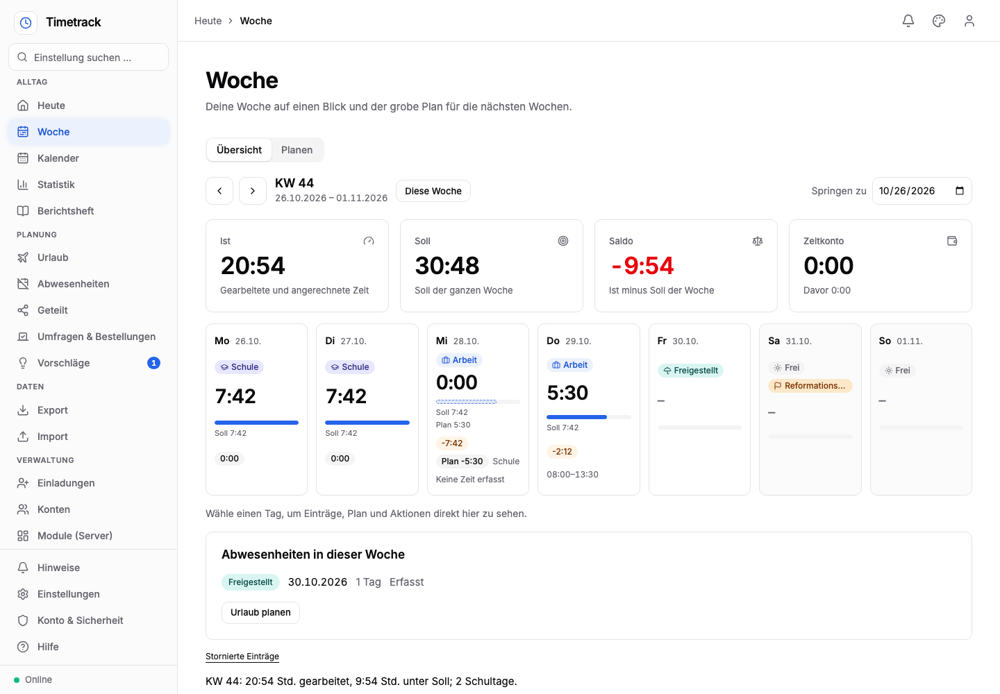
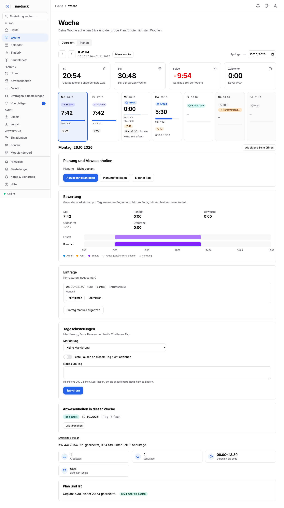
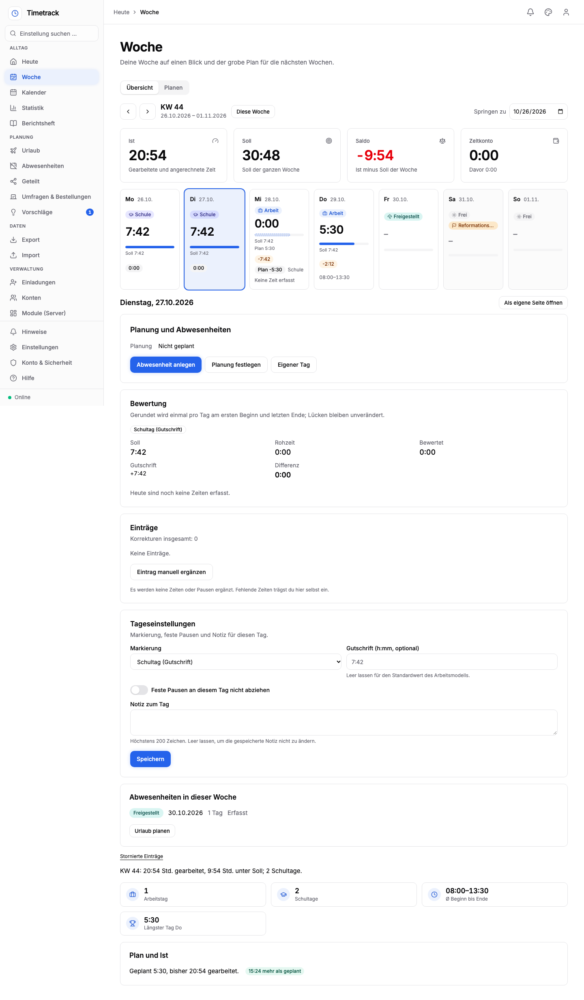
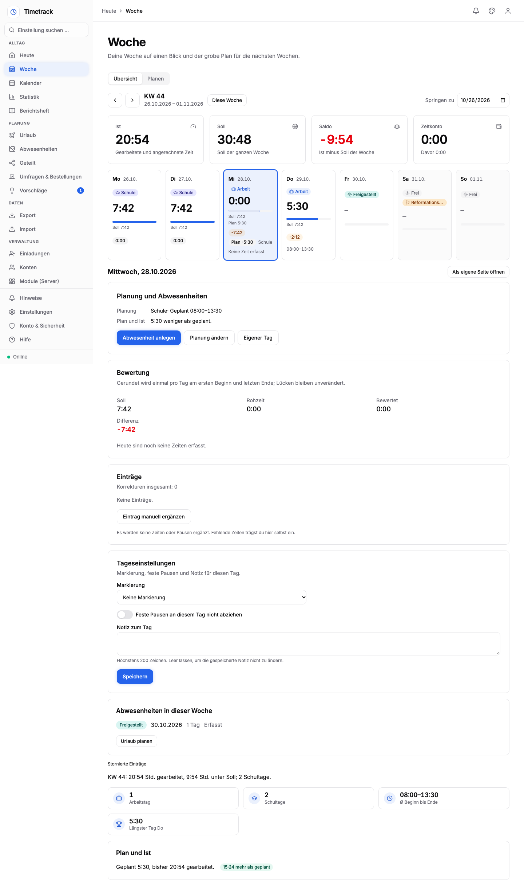
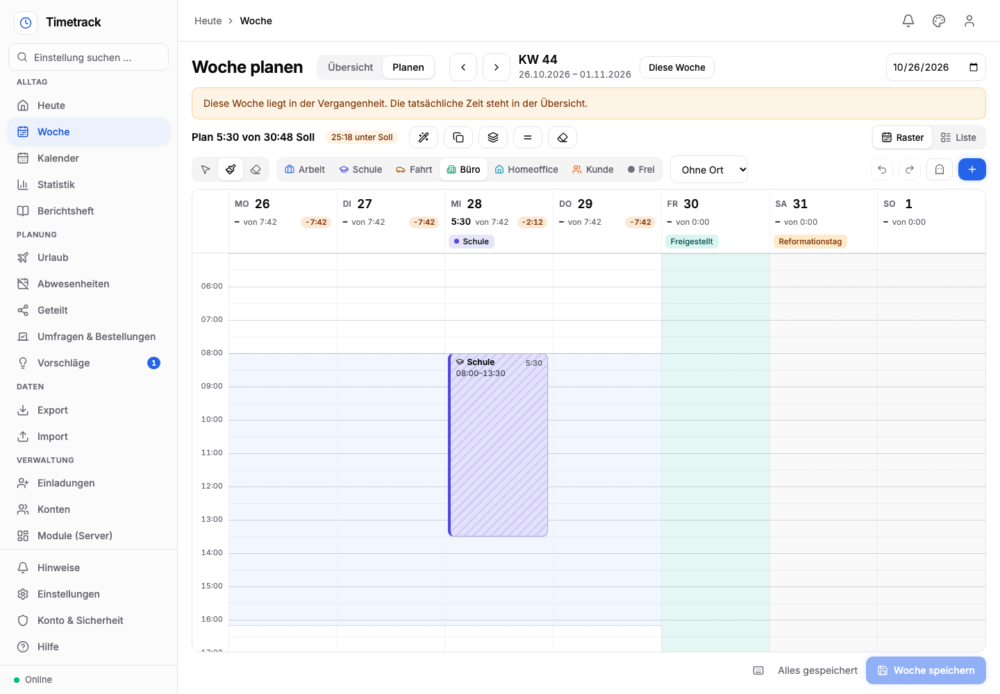
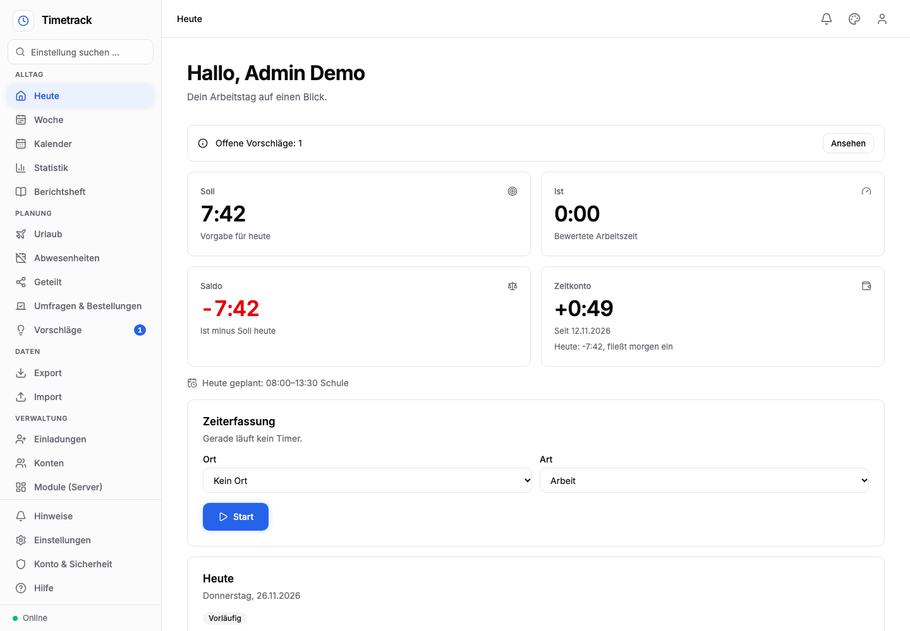
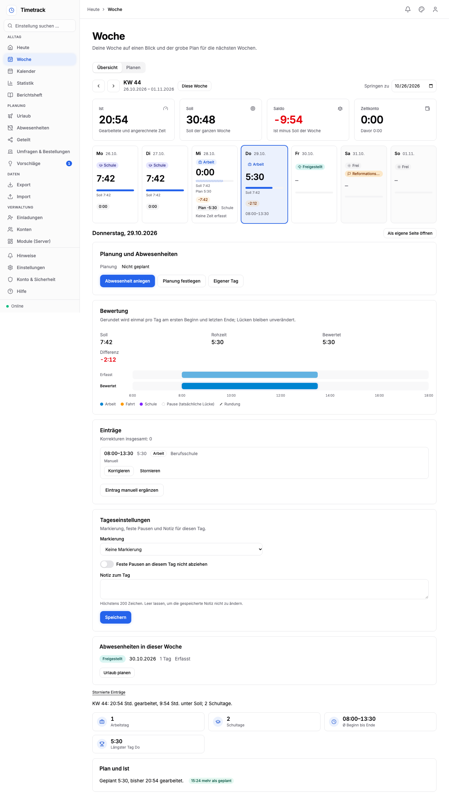

# UX-Prüfung: Schulzeit buchen (26.11.2026)

Auftrag Lino 26.11.: „Schulzeit richtig zu buchen ist sehr umständlich, es gibt 3 verschiedene Wege, nur einer ist eigentlich
richtig.“ Nur Analyse und Vorschlag, **noch kein Umbau**. Lino entscheidet per Review.

Arbeitsweise: Heuristische Prüfung nach Nielsen (Sichtbarkeit des Systemzustands, Fehlervermeidung, Konsistenz, Erkennen statt
Erinnern) plus Durchspielen jedes Wegs im Mock-Build. In dieser Umgebung gibt es keinen eigenen UX-Skill (nur Design- und
Artefakt-Skills), daher ohne Skill-Unterstützung.

**Umgesetzt am 26.11.2026** (Karte 218E0EBC): siehe [handoffs/SCHULZEIT.md](../handoffs/SCHULZEIT.md). Die Tabelle unten
beschreibt den Stand vor dem Umbau. Durchspiel-Test: `e2e-mock/ux-school-paths.spec.ts` (Screenshots mit
`SCREENSHOT_DIR=docs/ux/img`). Der Mock rechnet die Schulregel wie das Backend (ADR-0004, ADR-0028).

## Fachliche Regel (was „richtig“ heißt)

- **Schulregel (ADR-0004):** Ist-Abschnitte der Art `school` an einem Tag ≥ Schulschwelle (Standard 3:00) ⇒ der Tag gilt als
  voller Schultag mit Gutschrift (Standard = Tages-Soll, 7:42). Darunter zählt nur die tatsächliche Schulzeit.
- **Jugendprofil (ADR-0028):** Schultag = Tag mit Schulabschnitt; Unterrichtsstunden werden je Tag erfasst; 8-Stunden-Gutschrift
  einmal je Woche. Eine reine Tagesmarkierung reicht dafür nicht.
- **Planung bucht keine Ist-Zeit** (ADR-0031). Ein Plan „Schule“ ist nur eine Absicht.

Richtig ist also: **ein Ist-Abschnitt der Art „Schule“** (per Timer, manuell oder Import). Alles andere liefert entweder kein Ist,
falsche Art oder eine Gutschrift ohne Zeiten.

## Alle Wege im Überblick (durchgespielt in KW 44/2026, Soll 7:42 je Tag)

| Weg | Wo in der PWA | Was Nutzer tun | Ergebnis Soll / Ist / Diff | Wochenkarte | Bewertung |
|---|---|---|---|---|---|
| **A** Abschnitt Art „Schule“ | Heute → Timer (Art „Schule“), Tagesdetail → „Eintrag manuell ergänzen“, Import | 08:00–13:30 Schule | 7:42 / 7:42 (Gutschrift) / 0:00 | „Schule“ | **richtig** |
| **B** Tagesmarkierung „Schultag (Gutschrift)“ | Tagesdetail → Tageseinstellungen → Markierung | Markierung wählen, keine Zeiten | 7:42 / 7:42 (Gutschrift) / 0:00 | „Schule“ | Saldo stimmt, aber keine Zeiten: Jugendprofil, Statistik „Schule“, Ruhezeit- und Pausenhinweise sehen nichts |
| **C** Plan „Schule“ | Woche → Planen (Block „Schule“), Kalender → Planung | 08:00–13:30 Schule geplant | 7:42 / 0:00 / **−7:42** | „Arbeit“, „Keine Zeit erfasst“ | **falsch**: nichts gebucht, sieht aber wie erledigt aus |
| **D** Timer am Ort „Berufsschule“ mit Art „Arbeit“ | Heute → Timer (Vorbelegung „Arbeit“) | Start drücken | 7:42 / 5:30 / **−2:12** | „Arbeit“ | **falsch**: Schulregel greift nicht |
| **E** Abwesenheit „Freistellung“ | Kalender / Abwesenheiten | Freistellung für den Tag | 0:00 / 0:00 / 0:00 | „Freigestellt“ | Saldo neutral, aber kein Schultag (Statistik, Berichtsheft-Kontext, Jugendprofil fehlen) |
| (F) Import „Berufsschule“ | Import Arbeitszeit-Tabelle | Bemerkung „Berufsschule“/„BS“ | wie A | „Schule“ | richtig (wie A) |

Werte aus dem Testlauf (Mock, 26.11.2026):

```
A 2026-10-26 mark=none          soll=7:42 booked=0:00 credit=7:42 diff=0:00
B 2026-10-27 mark=school_credit soll=7:42 booked=0:00 credit=7:42 diff=0:00
C 2026-10-28 mark=none          soll=7:42 booked=0:00 credit=0:00 diff=-7:42
D 2026-10-29 mark=none          soll=7:42 booked=5:30 credit=0:00 diff=-2:12
E 2026-10-30 mark=excused       soll=0:00 booked=0:00 credit=0:00 diff=0:00
```

Die drei Wege, die Lino meint, sind sehr wahrscheinlich **A** (Abschnitt „Schule“), **B** (Markierung „Schultag“) und **C**
(Plan „Schule“); D und E sind typische Fehlbuchungen, die die Oberfläche zusätzlich nahelegt.

### Woche mit allen fünf Wegen



Mo (A) und Di (B) sehen gleich aus, obwohl B keine Zeiten hat. Mi (C) zeigt „Arbeit · 0:00 · Plan −5:30 Schule · Keine Zeit
erfasst“: der Plan ist sichtbar, die Lücke aber nur als kleine Zahl. Do (D) zeigt „Arbeit 5:30“ am Ort Berufsschule.

### Weg A im Tagesdetail (richtig, aber missverständlich angezeigt)



Befunde:
- „Rohzeit 0:00 / Bewertet 0:00 / Gutschrift +7:42“, obwohl 5:30 Schule erfasst sind. Nutzer lesen „0:00“ und glauben, die
  Buchung fehlt (Heuristik: Sichtbarkeit des Systemzustands).
- Im selben Bildschirm liegen alle drei Wege nebeneinander: „Planung festlegen“ (C), „Eintrag manuell ergänzen“ (A) und die
  Markierung „Schultag (Gutschrift)“ (B). Nichts sagt, welcher der richtige ist.
- „Plan und Ist“ meldet „15:24 mehr als geplant“, weil Gutschriften als gearbeitet zählen.

### Weg B: Tagesmarkierung



Die Markierung steht in derselben Liste wie Urlaub, Krank und Feiertag. Sie wirkt wie die „offizielle“ Art, einen Schultag
einzutragen, ersetzt aber die Zeiterfassung.

### Weg C: Plan „Schule“




Im Planer gibt es einen eigenen Pinsel „Schule“ mit Farbe und Muster. Nach dem Malen sieht der Tag fertig aus; dass keine
Ist-Zeit entstanden ist, merkt man erst am Saldo.

### Weg D: Timer



„Heute geplant: 08:00–13:30 Schule“ steht direkt über dem Timer, der trotzdem mit „Kein Ort“ und **Art „Arbeit“** vorbelegt ist.
Ein Klick auf „Start“ bucht am Schultag Arbeit. Nur wer den Ort „Berufsschule“ wählt (dessen Standardart „Schule“ ist), bekommt
die richtige Art; wählt man den Ort nachträglich, bleibt die Art oft unbemerkt auf „Arbeit“.



## Vorschlag: genau ein Weg – „Schultag buchen“ erzeugt immer einen Abschnitt „Schule“

**Leitsatz:** Schule ist Zeit, keine Markierung und kein Plan. Es gibt in der Oberfläche nur noch eine Handlung
**„Schultag buchen“**, und sie legt immer einen Ist-Abschnitt der Art „Schule“ an. Plan und Ort helfen nur beim Vorbelegen.

### 1. Heute: Timer folgt dem Plan

```
┌ Zeiterfassung ─────────────────────────────────────────────┐
│ Heute ist Berufsschule geplant (08:00–13:30).              │
│                                                            │
│ [ 🎓 Schultag buchen 08:00–13:30 ]   [ Timer: Schule ▶ ]   │
│                                                            │
│ Ort  [Berufsschule ▾]      Art  [Schule ▾]   ← vorbelegt   │
└────────────────────────────────────────────────────────────┘
```

- Ist heute „Schule“ geplant (Planmodus oder Schulblock), belegt der Timer **Art „Schule“ und den Schul-Ort** vor.
- Ein Knopf „Schultag buchen“ legt den Abschnitt mit den geplanten Zeiten in einem Schritt an (ohne Timer).
- Ort mit Ortsart „Schule“ setzt die Art immer auf „Schule“; wer trotzdem „Arbeit“ wählt, sieht den Hinweis
  „Am Ort Berufsschule wird Arbeit gebucht. Ist das richtig?“

### 2. Tagesdetail: eine Schaltfläche statt drei

```
┌ Montag, 26.10.2026 ────────────────────────────────────────┐
│ Geplant: Schule 08:00–13:30 · noch nichts gebucht          │
│ [ 🎓 Schultag buchen ]  [ Eintrag manuell ergänzen ]        │
├ Bewertung ─────────────────────────────────────────────────┤
│ Schule erfasst 5:30  →  voller Schultag, angerechnet 7:42  │
│ Soll 7:42 · Differenz 0:00                                 │
└────────────────────────────────────────────────────────────┘
```

- Bewertung zeigt „Schule erfasst 5:30 → angerechnet 7:42“ statt „Rohzeit 0:00 / Gutschrift +7:42“.
- Unter der Schwelle: „Schule erfasst 2:00 (unter 3:00) → zählt 2:00“.

### 3. Woche und Planer: Plan ist erkennbar nur Plan

```
┌ Mi 28.10. ──────────┐
│ 🎓 Schule geplant   │
│ ⚠ nichts gebucht    │
│ [ Schultag buchen ] │
└─────────────────────┘
```

- Vergangene oder heutige Tage mit Plan „Schule“ ohne Schulabschnitt bekommen den Hinweis „nichts gebucht“ und die Schaltfläche.
- Der Planer bleibt, wie er ist (Planung ist sinnvoll, z. B. für Urlaubsvorschläge „Berufsschultag“).

### 4. Umgang mit den anderen Wegen

| Weg | Künftig |
|---|---|
| A Abschnitt „Schule“ | **der eine Weg**, über „Schultag buchen“, Timer, manuell oder Import |
| B Markierung „Schultag (Gutschrift)“ | aus der Auswahl für neue Einträge entfernen; bestehende bleiben gültig und werden angezeigt mit „Schultag ohne Zeiten – jetzt Zeiten nachtragen?“. API und Import bleiben unverändert (Rückwärtskompatibilität, Apple-Apps). |
| C Plan „Schule“ | bleibt als Plan; dient nur noch zum Vorbelegen von „Schultag buchen“; Warnung „nichts gebucht“ |
| D Arbeit am Schul-Ort | verhindert durch Vorbelegung; sonst Rückfrage beim Start |
| E Freistellung | bleibt für echte Freistellungen; legt jemand eine Freistellung auf einen als Schule geplanten Tag, Hinweis „Für Berufsschule bitte ‚Schultag buchen‘ verwenden“ |

### 5. Vorhandene Fehlbuchungen

Eine einmalige Prüfliste „Schultage prüfen“ (Einstieg über die bestehende Vorschläge-Seite bzw. die Prüfmarkierungen aus P15):

```
┌ Schultage prüfen (3) ──────────────────────────────────────┐
│ Mi 28.10. Schule geplant, nichts gebucht   [Schultag buchen]│
│ Do 29.10. Arbeit am Ort Berufsschule       [In Schule ändern]│
│ Di 27.10. Schultag ohne Zeiten             [Zeiten nachtragen]│
│                                            [Alles so lassen] │
└────────────────────────────────────────────────────────────┘
```

- „In Schule ändern“ korrigiert nur die Art des Abschnitts (Korrektur mit Revision, nichts wird gelöscht).
- „Schultag buchen“ nutzt die Planzeiten.
- Nichts passiert automatisch; jede Zeile braucht eine Bestätigung. Stornierte Einträge bleiben nachvollziehbar.

## Offene Punkte für die Entscheidung

- Soll die Markierung B wirklich aus der Auswahl verschwinden, oder für „Schule ohne genaue Zeiten“ unter „Erweitert“ bleiben?
  Empfehlung: verschwinden, weil sie das Jugendprofil und die Statistik aushebelt.
- Standardzeiten für „Schultag buchen“ ohne Plan: aus dem Ort „Berufsschule“ (neues Feld) oder aus dem letzten Schultag?
  Empfehlung: letzter Schultag, kein neues Feld.
- Apple-Apps sollten denselben Weg bekommen (Parität); hier nicht Teil der Prüfung.
